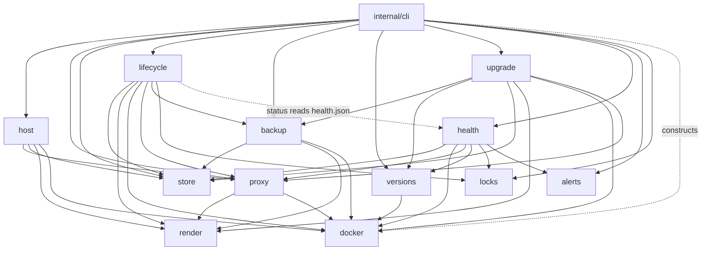

# Abyss specs: overview

Abyss (command `abyssctl`) runs and maintains several independent Actual Budget sync servers on one Docker
[Host](../../GLOSSARY.md), through their whole lifecycle: create, remove, [Upgrade](../../GLOSSARY.md),
[Backup](../../GLOSSARY.md) and [Restore](../../GLOSSARY.md). This page is the entry point for whoever builds it.
It states the problem, the scope and the standing constraints, maps the modules, and ends with an index of the
specs and ADRs in build order. Capitalised terms are defined in [GLOSSARY.md](../../GLOSSARY.md). Rules for
agents building Abyss are in [AGENTS.md](../../AGENTS.md); what comes after v1 is in
[ROADMAP.md](../../ROADMAP.md).

## How to use this pack

- **One spec at a time, in build order** (the [index](#index-in-build-order) at the end). Each spec goes through
  `/to-tickets`, then `/implement-spec`. A spec is the whole input: it restates every decision it needs and
  links only to other files in this repo.
- **A module spec carries its own capability end to end.** Its tickets include the CLI verb for that capability
  and its slice of the journey tests, so each ticket stays a vertical slice that can be demoed.
- **`cli.md` and `testing.md` hold only the shared conventions**: the verb table, output contract,
  confirmations, lock table, exit codes and `--json` schemas; the journey harness, test image cache, Makefile and
  CI. They are ticketed early, together with `foundation`, and grow as each verb and journey lands.
- **Part of `docs.md` is ticketed with step 1**, from docs.md: the reference generator `internal/cli/gendocs`, `make docs` and `make docs-check`, the `ci.yml` step, `internal/docscheck` with `TestLinks` and the help tests, `LICENSE`, and H2 skeletons of the six guides and `CONTRIBUTING.md`. So every
  later spec's reference pages and links are checked from its first ticket; the rest of `docs.md` is the last
  step.
- **Each spec's Interface section and acceptance list are the agreed test seams.** An implementer builds to
  them without asking. Every acceptance item is checked by a named test at the module's interface or by a
  journey; items no test can check (docs) are marked **(review)**.
- **A spec is done** when every acceptance item has its test, `make lint` is clean, `make test` passes, the
  journeys it adds or changes pass, and the docs it names are updated.

## The problem

Actual's own documentation sets up one sync server. An [Operator](../../GLOSSARY.md) who runs several (one per
household, family member or project) has to give each its own data, [Hostname](../../GLOSSARY.md) and TLS, then
keep all of them backed up and upgraded. Done by hand, that drifts. Two of Actual's behaviours also make the
obvious tools unsafe:

- **An Upgrade migrates data and can't be undone by changing the image tag.** An older Actual version refuses
  to start on data a newer one has migrated. A safe Upgrade takes a Backup first and puts that data back, with
  the old version, if the new version fails.
- **Putting back an old copy of a budget is silently undone by synced devices.** Devices that synced after the
  copy was made re-apply their newer changes. A safe Restore gives the budget a new sync identity (a
  [Regroup](../../GLOSSARY.md)), so those devices are told the budget was reset.

Abyss does this work as one command-line tool on the Host, the same way every time.

## The Operator

One person administers the Host and every [Instance](../../GLOSSARY.md) on it. They are at home in a Linux
shell, use `sudo`, and bring their own TLS [Certificate](../../GLOSSARY.md) (Hosts may be internal-only, with a
private CA). Abyss is open source so other Operators can run it the same way. Actual's own users, the people who
use each budget, never touch Abyss.

## Goals

- Run several Instances on one Host, each with its own data, Hostname and Actual version, reachable only through
  one tool-owned [Proxy](../../GLOSSARY.md).
- Make every changing operation safe: an all-or-nothing `create`, a final Backup before `remove`, a Backup
  before every Upgrade with automatic [Rollback](../../GLOSSARY.md), and a Restore that always Regroups.
- Find Problems before the Operator does: a periodic [Health check](../../GLOSSARY.md) that sends
  [Alerts](../../GLOSSARY.md) and keeps the [MOTD](../../GLOSSARY.md) current.
- Keep the Host simple: one binary, nothing installed beyond Docker and a few packages, and every file about an
  Instance generated from its small [Instance record](../../GLOSSARY.md).
- Show the Operator what will happen before it happens: a summary panel, a confirmation, and `--dry-run`.

## Non-goals

**Not planned** (also listed in [ROADMAP.md](../../ROADMAP.md)):

- More than one Host.
- Hosting for others (SaaS).
- A web UI.
- More than one administrator, or admin roles.
- Migrating Instances from other tools. An Operator moving to Abyss sets up a new Host and moves each budget
  with export and import in Actual's web UI.

**Not in v1, on the roadmap**, among others: a new tool version notice, a [Tool update](../../GLOSSARY.md)
command, clone (including restoring a Backup into a new Instance or from a removed Instance's Backups), Email
Alerts, per-kind Pushover priority, off-host and encrypted Backups, rename and `set-hostname`, Actual settings
and OpenID / multi-user, nightly or edge versions, unattended or bulk Upgrade, `doctor`, ACME / Let's Encrypt,
`host teardown`, moving the Data root or changing the [Base domain](../../GLOSSARY.md), and a read-only root
filesystem for Instances. [ROADMAP.md](../../ROADMAP.md) has the full list.

**Not in v1 and not on the roadmap:** unattended Tool updates, purging an Instance's Backups on `remove`, pids or
memory limits on containers, Docker image signature checks, a permission-drift Problem, `--quiet` /
`--verbose`, and `--json` on changing commands.

## v1 capabilities

Every command needs root except `version` and help (`--help`, `-h`, `help` and a bare `abyssctl`), which read only
what is compiled in. An unstamped development build refuses every other command (exit 2).

| Capability | Commands |
|---|---|
| [Bootstrap](../../GLOSSARY.md) and Tool update | `host setup` (idempotent: a re-run fixes drift and changes settings given as flags, but refuses with exit 2 to change `--data-root` or `--base-domain`; installing a newer binary is a re-run of the new binary), `version` |
| Proxy and Certificates | `cert install <cert.pem> <key.pem>`, `cert list`, `cert remove <id>`, `proxy upgrade [<version>]` |
| Instance life | `create <name> [--hostname H] [--version X.Y.Z] [--internet]`, `set <name> --internet=on\|off`, `remove <name>`, `remove --orphan <name>`, `list`, `status`, `start`, `stop`, `restart` |
| Inside an Instance | `logs <name>` or `logs proxy` (`-f`, `--tail N`), `exec <name> [-- <cmd…>]`, `reset-password <name>` (interactive only) |
| Upgrade | `upgrade <name> [<version>]` with automatic Rollback, `image prune` |
| Backup | `backup <name>`, `backup --all`, `backup list`, `backup prune <name> --keep N [--kind K]`, and a nightly scheduled Backup of every Instance with [Retention](../../GLOSSARY.md): the timer runs `backup --all --scheduled`, which skips a locked Instance and logs it |
| Restore | `restore <name> <backup-id>`, `restore <name> --latest`, or `restore <name>`, which shows a pick list on a TTY and with no TTY is refused (exit 2); `restore <name>` finishing an interrupted Restore shows no pick list and asks only the typed name; always followed by a Regroup |
| Health check | `health check` (run by a timer every 5 minutes by default, `HEALTH_INTERVAL`), `health clear <name>` |
| Alerts | Pushover, set with `alerts setup` and checked with `alerts test`; the MOTD shows current Problems and available updates |

Every changing command follows one output contract: timestamped `key=value` log lines and one outcome line.
Most changing commands show a summary panel first, and most of those ask before acting; which ones is in
[cli.md](cli.md)'s verb table. Commands that show a panel take `--dry-run`. `status`, `list`, `backup list`,
`health check` and `version` take `--json`. Exit codes are 0 done, 1 failed, 2 refused, 3 rolled back, 4 needs
the Operator. [cli.md](cli.md) owns the contract.

## Standing constraints

These hold for v1 and for everything on the roadmap. A roadmap item that would break one is dropped or
rethought.

- **One static binary.** Abyss is one statically linked Go binary (no cgo) for linux/amd64 and linux/arm64. Every
  template and every pin (Caddy image, minimum Docker Engine and Compose) is compiled in. See
  [ADR 0003](../adr/0003-single-static-go-binary.md).
- **Nothing on the Host beyond Docker and a few packages.** `host setup` installs Docker if it is missing, plus
  `ca-certificates`, `curl` and `openssl`, and uses systemd. No language runtime, no `jq`, no install script.
- **No Docker socket inside any container.** Abyss reaches Docker only through the `docker` and `docker compose`
  CLI on the Host.
- **No plugins.** No plugin system, hooks or external scripts. A new verb is a thin CLI function over existing
  modules; a new Alert channel is one more Adapter.
- **Few dependencies.** v1 uses three: Cobra (with `cobra/doc`), imported only by `internal/cli` (and `internal/cli/gendocs`);
  `modernc.org/sqlite`, for the offline Regroup without cgo; `golang.org/x/term`, for hidden input and TTY
  detection. Each new dependency needs a written reason in its owning spec's Decisions section.
- **The disk is the record.** An Instance exists exactly when its folder holds a valid Instance record.
  Everything else about it is generated from that record, and the disk wins over Docker. See
  [ADR 0002](../adr/0002-instance-folder-is-the-record.md).
- **[Secrets](../../GLOSSARY.md) are never shown.** Pushover credentials, Certificate private keys and anything
  inside an Instance's `data/` never appear in output, logs, `--json`, `--dry-run` panels, manifests or Alerts.
  Pushover credentials may be shown masked as `…abcd` (for example in the `host setup` panel). `logs` and `exec`
  pass the container's output through unfiltered (it is the Operator's own data) and are never logged. The tool
  runs with `umask 077` and writes every file via temp file → chmod → rename.
- **No [Internet access](../../GLOSSARY.md) unless the Operator turns it on.** Every Instance joins the
  internal-only network `abyssctl`, so it is reached only through the Proxy and reaches nothing outside the Host.
  An Instance with Internet access (`create --internet`, or `set <name> --internet=on`) also joins the ordinary
  bridge network `abyssctl-external` and leaves through it. No Instance publishes a port. See
  [ADR 0005](../adr/0005-internet-access-per-instance.md).
- **Times.** Machine-facing times are UTC: file names, `--json`, Backup manifests, `outcomes.json`,
  `health.json` and `CREATED_AT`. Times people read are Host local time: progress lines (`HH:MM:SS`), tables,
  the MOTD and Alert text, with the zone abbreviation wherever a date is shown (`2026-11-17 03:00 EST`). The
  activity log uses RFC 3339 local time with its offset (`2026-11-17T03:00:04-05:00`). Schedules and settings
  such as `BACKUP_TIME` are local. The tool never changes the Host's time zone.

## Conventions every module follows

- **Modules emit events and never print.** Each module's constructor takes an `Emitter`; the CLI turns events
  into log lines and panels. `Event`, `Emitter` and the typed errors are defined in [foundation.md](foundation.md).
- **Typed errors map to exit codes:** `ErrRefused` → 2, `ErrRolledBack` → 3, `ErrNeedsOperator` → 4, anything
  else (including a lock timeout) → 1.
- **Each operation the CLI shows a panel for has a `Plan…` twin** (every verb with `--dry-run` in [cli.md](cli.md)'s
  verb table). The twin returns the summary without locking or acting. The CLI renders it as the summary panel and
  for `--dry-run`. A verb with no panel, such as `start` or `backup`, has no twin.
- **The CLI takes the locks**, from the per-verb lock table in [cli.md](cli.md): always the Host lock first, then
  the Instance lock. For `host setup` and `image prune` it takes the Host lock, then every Instance lock in name
  order, before calling the module; `image prune` builds its panel unlocked and reads the in-use images again
  under the locks. `start` and `restart` release the Host lock once the site file is written (Lifecycle
  calls `Options.AfterSite`), so compose up and the wait for healthy hold only the Instance lock. For `backup --all --scheduled` it try-locks each Instance and skips (and logs) a busy one. A
  module spec states "caller holds X" as a precondition and never locks, with two exceptions: Health try-locks each
  Instance inside `Check`, so it can skip a busy one, while the CLI holds the health lock that keeps two Health
  checks (or a check and `health clear`) apart; and Lifecycle's `Create` locks the staged Instance's lock
  between Store's `Stage` and `Commit`, so the new Instance is locked from the moment it is visible.
- **Every path comes from one paths value**, which tests point at a temp folder. Anything reached over HTTP takes
  an injectable address: the registry and Pushover take a base URL and an `http.Client`; the Proxy probe takes
  `ProbeAddr` and builds its own `http.Transport`, because the SNI and the coverage check live there
  ([proxy.md](proxy.md)).

## Module map

One Go module. `cmd/abyssctl/main.go` is tiny; the CLI layer is `internal/cli`, the only package that imports
Cobra. It parses arguments, takes locks, asks for confirmation and prints. Each module below is a package under
`internal/` with its own spec. [foundation.md](foundation.md) also provides small shared packages that any
module may import: `internal/buildinfo` (stamped and compiled-in values), `internal/hostfs` (the paths value and
the atomic file write) and `internal/op` (`Event` / `Emitter`, the typed errors, `Summary` and the `Clock`).

| Module (package) | Interface (gist; its spec owns the detail) | Hides |
|---|---|---|
| Docker (`docker`) | Compose up / stop / down / ps; container inspect, list by label and remove; image pull, inspect, list, remove; network create (bridge, optionally internal) and inspect (driver, internal, subnets); `exec` with captured output and interactive passthrough; `run --rm`; Engine and Compose versions | the `docker` / `docker compose` CLI and its `--format json` output |
| Locks (`locks`) | `Acquire(path, wait)`, `TryAcquire(path)` | `flock` (the CLI passes the 30 s wait) |
| Instance store (`store`) | `List`, `Get`, `Put`, `WriteCompose`, `CheckNew` / `Stage` / `Commit` / `Discard`, `Remove`, `Sweep`, outcomes | record parse, validate and write, folder layout, name rules, `.creating` folders, `outcomes.json` |
| Renderer (`render`) | Instance `compose.yaml`, an Instance's site file (`Site(SiteInput)`), Caddyfile, Proxy `compose.yaml`, systemd units, MOTD script, logrotate rule | pure templates, no I/O |
| Host (`host`) | `Setup(opts)`, `ReadSettings(paths)`, `SetPushover`, `Account()` | OS detection, Docker install and check, the system account, folders and modes, the two networks, timers, MOTD script, logrotate, drift fixes (inspect → plan → apply); the only writer of `abyssctl.env` |
| Proxy (`proxy`) | add and remove a site, install, list and remove Certificates, coverage, `Probe(ctx, hostname, path)`, Proxy upgrade to a version the caller resolved | write → validate → reload, Certificate choice and coverage, the Caddy container, `proxy.env` (its only writer), the Proxy upgrade target rule |
| Lifecycle (`lifecycle`) | `Create` (given a resolved version and digest), `Set` (Internet access), `Remove`, `Start`, `Stop`, `Restart`, `Status`, `List`, logs, `exec`, `reset-password` | ordering, all-or-nothing `create`, final Backup on `remove`, wanted vs. actual state |
| Backup (`backup`) | `Create`, `List`, `Prune`, `Restore`, `Revert`, `Finish`, `Interrupted`, `ParseID` | stop-copy-start, archive and manifest, verification, Retention, Regroup |
| Versions (`versions`) | `Latest(repo)`, `Resolve(repo, version)`, image prune | registry tag lookups (anonymous bearer token), stable-version rules, finding unused images |
| Upgrade (`upgrade`) | `Target(name, version)`, then `Upgrade(name, target, options)` | pre-flight → Backup → switch → verify → automatic Rollback; finishing an interrupted Upgrade |
| Alerts (`alerts`) | `Send(alert) error` | the Pushover Adapter |
| Health (`health`) | `Check()`, `Clear(name)`, read state | probes, Live and Event [Problems](../../GLOSSARY.md), debounce, `health.json`, `motd.txt`, sending Alerts |

The real seams, each with a production Adapter and a fake, are Docker, Alert channels and the clock.

### Dependencies

An arrow means "calls". There are no cycles.

- **Leaves:** Store, Renderer, Docker, Locks and Alerts call no other module. The Renderer still imports
  `internal/docker/names` (constants only, standard library alone) for the names it writes, so it is a leaf among
  modules but not free of `internal/` imports.
- **Proxy is fed what it needs.** Callers pass it the Hostnames in use, so it never reads Instance records. For
  the `cert` verbs the CLI gets every Hostname from `store.List`.
- **The CLI resolves versions through Versions.** For `create` it resolves `--version` (or the latest stable
  Actual) to a version and digest and passes both to `lifecycle.Create`. For `proxy upgrade` it asks Versions for
  the latest stable Caddy (or resolves the version given) and passes it in; Proxy then applies its rule: the
  binary's compiled-in Caddy pin when that is newer than the running Proxy, otherwise the latest stable; an
  older version is refused.
- **Each settings file has one writer.** Host alone writes `abyssctl.env`; `alerts setup` writes the Pushover
  keys through Host, not with a writer of its own. Proxy alone writes `proxy.env`. Renderer renders the logrotate
  rule and Host installs it.
- **Backup works below Lifecycle.** It stops, copies and starts an Instance through Docker directly; Lifecycle
  calls Backup, never the other way round.
- **Upgrade uses Proxy only to probe** the Instance through its Hostname.
- **Health is the only module that sends Alerts.** Backup and Upgrade record what happened in the Instance's
  `outcomes.json`; the next Health check turns it into a Problem. The one exception is `alerts setup` and `alerts test`,
  where the CLI calls `Send` directly: a test message is not an Alert.
- **`status` lives in Lifecycle.** It shows live Docker state plus the Problems and available updates that
  Health last wrote to `health.json`, with the time they were checked.
- **`image prune` lives in Versions.** The CLI passes it the images still in use (every Instance record's pin,
  read through `store.List`, and the Proxy's), so Versions needs nothing but Docker. It only ever removes
  Actual and Caddy images; it never touches an image from any other repo.

## Capabilities, modules and journeys

Each capability is a CLI verb over one or more modules and is proven end to end by a journey test. Journeys are
numbered as in [testing.md](testing.md).

| Capability | Modules | Journey |
|---|---|---|
| `host setup`: Bootstrap, re-run, drift fixes | Host, Proxy, Renderer, Store, Docker | 1 Bootstrap |
| Tool update, downgrade refusal, files out of date | Host, Store | 2 Tool update |
| `create`, `set`, `remove`, `remove --orphan`, `list`, `status`, `start`, `stop`, `restart` | Lifecycle, Versions, Store, Renderer, Proxy, Backup, Docker | 3 Instance life |
| `logs`, `exec` | Lifecycle, Docker | 3 Instance life |
| `reset-password` | Lifecycle, Docker | manual step in the Release check (needs a TTY) |
| `cert install`, `cert list`, `cert remove`, `proxy upgrade` | Proxy, Renderer, Versions, Docker | 4 Proxy and Certificate |
| `backup`, `backup --all`, `backup list`, Restore and Regroup | Backup, Store, Renderer, Docker | 5 Backup and Restore |
| Scheduled Backup and Retention | Backup, Store, Docker, Host (timer) | module tests with a fixed clock; the timer unit in 1; one scheduled run in 5 (step 7) |
| `upgrade`, Rollback, `image prune`, `backup prune` | Upgrade, Versions, Backup, Store, Renderer, Proxy, Docker | 6 Upgrade and Rollback |
| `health check`, `health clear`, `alerts setup`, `alerts test`, MOTD | Health, Alerts, Host, Versions, Proxy, Store, Docker, Locks | 7 Health and Alerts |
| Output contract: panels, `--dry-run`, `--json`, confirmations, exit codes, root check, `version`, activity log | CLI | 8 Output contract; the activity log by `cli` module tests against a temp log path |

## Host layout

Defaults are shown. `/etc/abyssctl/abyssctl.env` is the one fixed settings path; it names the Data root as
`DATA_ROOT` (chosen at Bootstrap with `--data-root`, `/srv/abyssctl` by default) and holds `BASE_DOMAIN`; both
are fixed after the first `host setup`. Every other path is built from the settings path and `DATA_ROOT`. A
folder is the tool's [Data root](../../GLOSSARY.md) only when `abyssctl.env` names it.

**Under the Data root, everything is root:root, folders 0700 and files 0600, except `data/` and
`data.pre-restore/`.** `host setup` resets every owner and mode below on each run; inside `data/` it only runs
`chown -R` to the `abyssctl` account, and file modes stay as Actual writes them.

| Path | What it holds | Owner | Mode |
|---|---|---|---|
| `/usr/local/bin/abyssctl` | the binary | root:root | 0755 |
| `/etc/abyssctl/` | Host settings | root:root | 0700 |
| `/etc/abyssctl/abyssctl.env` | `DATA_ROOT`, `BASE_DOMAIN`, Health check, Backup and Alert settings, Pushover credentials | root:root | 0600 |
| `<data root>/` | everything below | root:root | 0700 |
| `instances/<name>/` | one folder per Instance | root:root | 0700 |
| `instances/<name>/instance.env` | the Instance record | root:root | 0600 |
| `instances/<name>/compose.yaml` | generated from the record | root:root | 0600 |
| `instances/<name>/outcomes.json` | last scheduled Backup and last Upgrade result | root:root | 0600 |
| `instances/<name>/.lock` | the Instance lock | root:root | 0600 |
| `instances/<name>/upgrade-failed-<stamp>.log` | container logs from a failed Upgrade | root:root | 0600 |
| `instances/<name>/data/` | Actual's `/data`, bind-mounted | abyssctl:abyssctl | the folder 0700; contents as Actual writes them |
| `instances/<name>/data.pre-restore/` | the old `data/`, moved aside while a Restore runs | abyssctl:abyssctl | as `data/` |
| `instances/.<name>.creating/` | an Instance being built by `create` | root:root | 0700 / 0600 |
| `instances/.<name>.creating/.lock` | the lock of an Instance being built, renamed with the folder to `instances/<name>/.lock` | root:root | 0600 |
| `instances/.<name>.removing/` | an Instance folder being deleted by `remove` | root:root | 0700 / 0600 |
| `backups/<name>/` | Backups: `<id>.tar.gz`, `<id>.tar.gz.sha256`, `.partial` while writing | root:root | 0700 / 0600 |
| `backups/removed/<name>-<stamp>/` | Backups of a removed Instance, kept until the Operator deletes them | root:root | 0700 / 0600 |
| `proxy/` | `Caddyfile`, `compose.yaml`, `proxy.env` (Proxy version and digest) | root:root | 0700 / 0600 |
| `proxy/sites/<name>.caddy` | one generated site file per Instance | root:root | 0700 / 0600 |
| `proxy/certs/<id>.{crt,key}` | Certificates, `<id>` = the first 12 hex digits of the SHA-256 fingerprint | root:root | 0700 / 0600 |
| `proxy/caddy-data/`, `proxy/caddy-config/` | Caddy's own writable state | root:root | 0700 |
| `state/` | `health.json`, `motd.txt`, `host.lock`, `health.lock` | root:root | 0700 / 0600 |
| `/var/log/abyssctl/`, `abyssctl.log` | the activity log (never holds Secrets) | root:adm | 0750 / 0640 |
| `/etc/systemd/system/abyssctl-{health,backup}.{service,timer}` | Health check (every 5 min by default) and nightly Backup (03:00 local by default) | root:root | 0644 |
| `/etc/update-motd.d/90-abyssctl` | MOTD script: checks the age of `state/motd.txt` and prints it | root:root | 0755 |
| `/etc/logrotate.d/abyssctl` | rotation for the activity log | root:root | 0644 |
| `/etc/apt/keyrings/docker.asc`, `/etc/apt/sources.list.d/docker.sources` | Docker's apt source, only when Host installed Docker | root:root | 0644 |

Bind mounts are resolved by the root Docker daemon, so the root-only parents don't stop an Instance reaching
its `data/`.

**Runtime accounts and containers:**

- `abyssctl` is a system account (system-range UID and GID allocated by `host setup`, nologin shell, no home).
  Every Instance container runs as that account's actual UID:GID, with `cap_drop: [ALL]` and
  `no-new-privileges`. There are no per-Instance accounts, and the Operator is not added to the `docker` group.
- The Caddy Proxy runs as root inside its container, with `cap_drop: [ALL]`, `cap_add: [NET_BIND_SERVICE]`,
  `no-new-privileges` and `read_only: true`.
- Only the Proxy publishes ports (80 and 443). The Proxy joins both networks: `abyssctl`, to reach Instances, and
  `abyssctl-external`, because Docker publishes ports only from a network that is not internal. Every Instance
  sits on `abyssctl`; an Instance with Internet access also sits on `abyssctl-external`. The Proxy reaches an
  Instance by its network alias.

**Docker names:**

| Thing | Name |
|---|---|
| Instance Compose project and container | `abyssctl-<name>`, also its network alias |
| Instance label (finds [Orphans](../../GLOSSARY.md)) | `io.abyssctl.instance=<name>` |
| Proxy Compose project and container | `abyssctl-proxy` (so `proxy` is a reserved Instance name, as are `all` and `removed`) |
| Private network | `abyssctl`: bridge, internal (no internet); the Proxy and every Instance join it; subnet assigned by Docker, read back for `ACTUAL_TRUSTED_PROXIES` |
| External network | `abyssctl-external`: bridge, not internal; the Proxy and each Instance with Internet access join it; subnet assigned by Docker, read back for `ACTUAL_TRUSTED_PROXIES` of an Instance with Internet access |

## Supported Hosts

- Debian 13, Ubuntu 24.04 and 26.04, and TurnKey Core 19 (treated as its Debian base), each on amd64 and arm64,
  detected from `/etc/os-release`. `host setup` refuses anything else unless `--unsupported` is passed.
- Docker Engine 25.0.5 or newer with Compose 2.24 or newer. If Docker is missing, `host setup` installs it from
  Docker's official apt repository. An existing Docker that meets the minimums is used as is; `host setup` never
  upgrades Docker or edits `daemon.json`.
- A shared Host is allowed. `host setup` refuses only on a concrete conflict: ports 80 or 443 in use, the
  `abyssctl` or `abyssctl-external` network name taken by a network of the wrong kind, the Proxy name taken, or a
  non-empty Data root the tool doesn't own. Other containers and
  services get a warning.
- Firewall, SSH, OS updates and Docker daemon hardening are left to the Operator. Rootless Docker and
  userns-remap are not supported.

## Index, in build order

Steps 1–7 are the tracer bullet: by the end of `lifecycle`, a Host can be set up and an Instance created, reached
through the Proxy and removed. `cli.md` and `testing.md` are ticketed with `foundation` and grow as each verb and
journey lands; their step numbers mark when they are complete, not when they start. Each has a base that is built
early: the parts that need `internal/locks` (the CLI's lock helper and busy-lock message) or
`internal/docker/dockertest` (the journey harness) are blocked by `docker-and-locks`, and the whole base is done
before `proxy`, whose `cert` verbs are the first to use panels, prompts, locks and the activity log. `lifecycle` builds the part of `backup.Create` that `remove` needs for its final Backup, to the
interface in [backup.md](backup.md); `status` shows Problems and available updates once `health` lands.

| # | Spec | Covers |
|---|---|---|
| 1 | [foundation](foundation.md) | `go.mod` and toolchain, `cmd/` + `internal/` layout, `internal/buildinfo` and the pins file, the paths value and `Stamp` (file-name timestamps), `Event` / `Emitter`, `Mask`, typed errors, `Summary` (the `Plan…` return type), the `Clock`, the atomic file write, `umask 077`, the stamped-build and root checks, `abyssctl version`, Makefile `tools` / `lint` / `test` / `build`, `.golangci.yml`, the import-rules test, lint and test CI |
| 2 | [docker-and-locks](docker-and-locks.md) | the Docker adapter and its fake; Instance and Host locks |
| 3 | [store](store.md) | the Instance store, the Instance record format, `outcomes.json` |
| 4 | [render](render.md) | the Renderer and every generated file |
| 5 | [proxy](proxy.md) | the Caddy Proxy, site files, Certificates and coverage, the probe, `cert` verbs, the Proxy upgrade operation (module and `cert` verb tests; the `proxy upgrade` verb lands with `versions`; its journey slices land with `host` and `lifecycle`) |
| 6 | [host](host.md) | `host setup`: Bootstrap, settings, drift fixes, Tool update by re-run; wires the real Proxy and lands journey 1 |
| 7 | [lifecycle](lifecycle.md) | `create`, `set`, `remove`, `list`, `status`, `start`, `stop`, `restart`, `logs`, `exec`, `reset-password`; lands journeys 2 and 3 |
| 8 | [backup](backup.md) | Backup, Backup kinds, verification, Retention, Restore, Revert, Regroup |
| 9 | [versions](versions.md) | latest stable Actual and Caddy versions, resolving a version to a digest, `image prune`, the `proxy upgrade` verb (wiring Proxy's upgrade, journey 4's upgrade step) |
| 10 | [upgrade](upgrade.md) | Upgrade, verify, automatic Rollback, interrupted Upgrades |
| 11 | [alerts](alerts.md) | `Send(alert)`, the Pushover Adapter, `alerts setup`, `alerts test` |
| 12 | [health](health.md) | the Health check, Problems, `health.json`, `motd.txt`, `health check`, `health clear` |
| 13 | [cli](cli.md) | ticketed with step 1, base built after step 2 and before step 5: the verb table, output contract, confirmations, lock table, `--dry-run`, `--json` schemas, exit codes, activity log |
| 14 | [testing](testing.md) | ticketed with step 1, base built after step 2 and before step 5: the journey harness, the eight journeys, the fake Actual image, the test image cache, Makefile targets, journey CI |
| 15 | [release](release.md) | the tag workflow, draft Release, Release check, repo-setup checklist |
| 16 | [docs](docs.md) | README, the six guides, the generated reference, `LICENSE`, `SECURITY.md`, `CONTRIBUTING.md`, bug template (the generator, `make docs`/`docs-check`, its CI step, the docs tests, `LICENSE` and the guide and `CONTRIBUTING.md` skeletons are ticketed with step 1) |

### ADRs

| # | Decision |
|---|---|
| [0001](../adr/0001-tool-owned-caddy-proxy.md) | The tool runs its own Caddy Proxy container |
| [0002](../adr/0002-instance-folder-is-the-record.md) | Each Instance's folder is its only record |
| [0003](../adr/0003-single-static-go-binary.md) | The tool is one static Go binary |
| [0004](../adr/0004-restore-regroups-offline.md) | Restore brings back the Backup's Actual version and Regroups offline |
| [0005](../adr/0005-internet-access-per-instance.md) | Instances have no Internet access unless the Operator turns it on |
